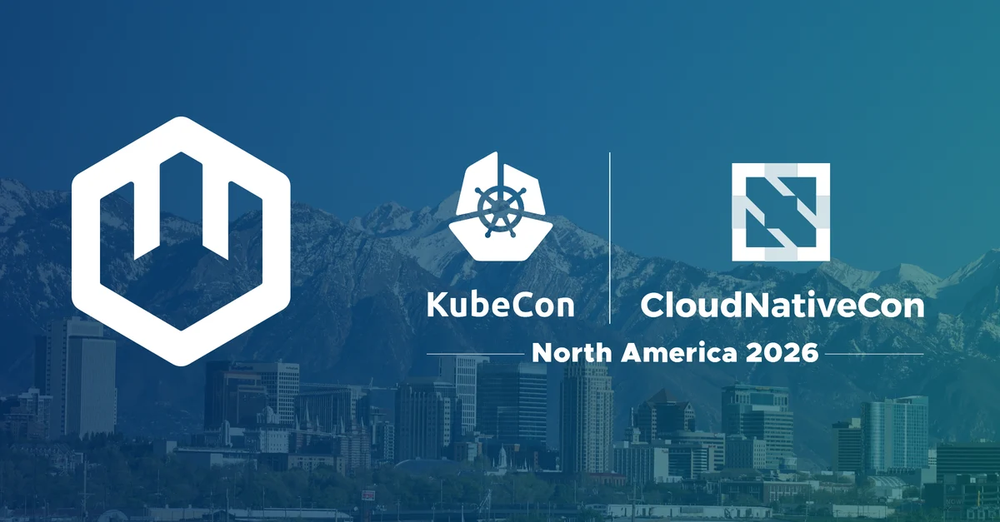

Heading to **[KubeCon + CloudNativeCon NA 2026](https://events.linuxfoundation.org/kubecon-cloudnativecon-north-america/)** in Salt Lake City, November 9-12? Come and say hello to the wasmCloud team! You can find wasmCloud maintainers in the **Project Pavilion**, and maintainers are leading a hands-on workshop on sandboxing on Kubernetes and a talk on portable GPU compute with WASI WebGPU.

{/* truncate */}

## Where to find us

Tuesday through Thursday, you can chat with wasmCloud maintainers in the **Project Pavilion** on the Solutions Showcase floor (Salt Palace, Level 1, Hall 5). Stop by to ask questions, see a demo, talk about what you're building, or just pick up some stickers.

## What's new in wasmCloud

A lot has changed since we last saw many of you in Atlanta. A few things we'd love to talk about:

- **wasmCloud v2 on Kubernetes.** Workloads are custom resources you apply with `kubectl`, the runtime operator places them on hosts, and the host pods run alongside your ordinary Deployments, with the RBAC, admission and network policies you already use. The latest release is [v2.12.1](https://github.com/wasmCloud/wasmCloud/releases/tag/v2.12.1).
- **Sandboxing by default.** Every component starts with no access to files, the network or credentials, and gets only what its manifest grants. That makes wasmCloud a natural fit for running code you don't fully trust, including AI agents and the tools they call.
- **Density you can measure.** In the project's [published density benchmark](https://arewefastyet.wasmcloud.com/density.html), one 64-core host kept 1.42 million components warm and answering requests, and held 9.69 million scaled to zero. The data and method are public, so come ask us how it works.

## Workshop: Sandboxing on Kubernetes with WebAssembly

[Sandboxing on Kubernetes with WebAssembly: A Hands-on Tutorial](https://events.linuxfoundation.org/kubecon-cloudnativecon-north-america/program/schedule/?id=1245965) - Bailey Hayes & Eric Gregory, Cosmonic  
Wednesday, November 11, 4:10 PM - 5:30 PM MST, Hyatt Regency | Level 4 | Regency Ballroom A

In this hands-on workshop, you'll deploy a sandboxed AI agent to your own local Kubernetes cluster with wasmCloud. Then you'll give the agent familiar tools like `curl` and `sqlite3`, try each tool's most famous escapes, and watch them fail at the grant. Finally, you'll put the agent to work triaging real wasmCloud pull requests on GitHub.

The workshop is designed for engineers and platform operators with basic Kubernetes familiarity. No prior experience with Rust or WebAssembly is required.

**Get set up before the session.** Conference Wi-Fi can be slow, so please download the toolchains ahead of time. You'll need Docker (Docker Desktop, OrbStack, or Podman) with 4 GB or more of memory on macOS or Linux, or WSL2 on Windows. Clone the [workshop repo](https://github.com/cosmonic-labs/sandbox-workshop-kcna26) and run:

```shell
git clone https://github.com/cosmonic-labs/sandbox-workshop-kcna26
cd sandbox-workshop-kcna26
make tools doctor up
```

`make tools` downloads pinned, checksum-verified tools into the repo (nothing is installed system-wide, and nothing needs `sudo`), `make doctor` checks your machine, and `make up` starts a local kind cluster with wasmCloud. Prefer not to install anything? The workshop also runs in GitHub Codespaces.

## Talk: GPU portability with WebGPU

### Cloud Native AI + Inference Day on Monday, November 9

[GPU Portability Was Broken but Now There's WebGPU](https://events.linuxfoundation.org/kubecon-cloudnativecon-north-america/co-located-events/cncf-hosted-co-located-schedule/?id=1268234) - Bailey Hayes & Mendy Berger, Cosmonic  
1:30 PM - 1:55 PM MST, Salt Palace | Level 2 | 254

Running AI inference on Kubernetes usually means choosing between vendor-specific runtimes, driver lock-in, and operator configurations that break across clouds. Bailey and Mendy will show a different approach: `wasi:webgpu`, an open, vendor-neutral interface that brings the WebGPU standard to the server. A sandboxed component simply declares GPU access as a capability, and wasmCloud makes it schedulable on Kubernetes.

You'll see ONNX models running inference through `wasi:webgpu` with no framework-specific operator or driver assumptions, so the same component runs on a data center GPU or a consumer GPU in an edge cluster. Then the talk goes beyond AI, with GPU-accelerated image processing and scientific compute running as ordinary distributed workloads.

## Security Slam Awards Ceremony

**Security Slam Awards Ceremony** - Bailey Hayes, accepting for wasmCloud  
Thursday, November 12, 10:45 AM - 11:10 AM MST, Salt Palace | Level 1 | Hall 5 | Project Pavilion Stage

wasmCloud took part in [Security Slam 2026 Fall Edition](https://www.cncf.io/blog/2026/09/25/security-slam-2026-fall-edition/), the month-long open source security challenge from CNCF TAG Security & Compliance and the OpenSSF, where projects work through security hygiene milestones suited to their maturity. Bailey will accept wasmCloud's award at the ceremony on the Project Pavilion Stage. Come cheer on the project, then say hello to the maintainers in the Project Pavilion.

## More wasmCloud at the show

Cosmonic, a wasmCloud maintainer company, is also exhibiting at **Booth 224** in the Solutions Showcase, where you can find more wasmCloud maintainers.

## Join the community

Whether or not you can make it to Salt Lake City, the wasmCloud community is always open. Join us in the [wasmCloud Slack](https://slack.wasmcloud.com/) to stay up to date on the project, ask questions, and connect with maintainers and contributors around the world.

Hope to see you in Salt Lake City!

_Header photo: [Salt Lake City skyline](https://commons.wikimedia.org/wiki/File:SLC_Skyline_2024.jpg) by Invictus323, [CC BY 4.0](https://creativecommons.org/licenses/by/4.0/), via Wikimedia Commons, tinted and cropped._
